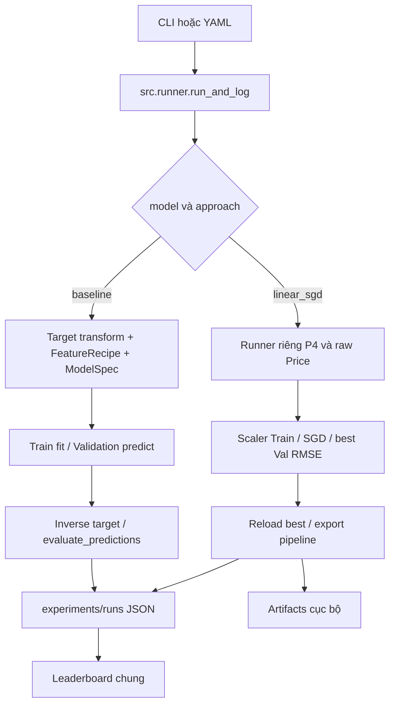

# Context dự án dự đoán giá nhà để triển khai method train tiếp theo

Cập nhật ngày 24/11/2026, đối chiếu source tại commit `83bb741` và workspace hiện tại. Tài liệu dùng để bàn giao cho thành viên hoặc coding agent triển khai một method mới. Phần mô tả hiện trạng và phần đề xuất mở rộng được phân biệt rõ; không có method mới nào được triển khai hoặc train trong lần xuất context này.

Dự án dự đoán `Price` liên tục, đơn vị **tỷ VND**. Luồng chuẩn dùng frozen split chung và leaderboard trong `experiments/`. Workspace đồng thời có một luồng TensorFlow độc lập trong `training_approaches/linear_sgd/`; luồng này **chưa dùng cùng split và feature P4**, nên kết quả của nó không thể xếp cạnh leaderboard chung như cùng một benchmark.

## 1. Thứ tự đọc và các quy tắc giữ nguyên

Đọc [AGENTS.md](../AGENTS.md), [dataset investigation](dataset-investigation.md), [leaderboard chung](../experiments/leaderboard.md), rồi [tài liệu Linear SGD](approach_1_linear_sgd.md).

Các điều kiện cho một run được so sánh trên leaderboard chung:

- Dùng `experiments/splits/splits_v1.json`; không tự chia lại hoặc đổi thứ tự dòng CSV.
- Fit imputer, scaler, encoder, TF-IDF/SVD và mọi prior chỉ từ Train. Validation/Test chỉ transform và predict.
- `Price` không nằm trong input model; không tính `Price/Area` từ nhãn của dòng cần dự đoán. Prior học từ Train được áp dụng bằng trạng thái đã fit, không đọc nhãn Validation/Test.
- Không dùng Test để tune, early stopping hoặc chọn checkpoint. Chỉ đánh giá Test khi chốt ứng viên cuối cùng.
- Mọi metric báo cáo phải ở đơn vị tỷ VND sau khi đảo target transform.
- Đăng ký model/features/target mới; không đổi defaults của baseline để chạy thử.
- Run qua `scripts/run_experiment.py` hoặc `src.runner.run_and_log`, ghi một JSON riêng vào `experiments/runs/`, rebuild leaderboard bằng `scripts/build_leaderboard.py`.
- Không commit raw/processed data hoặc binary model. Nếu sửa slides, đọc `slides/AGENTS.md` trước.

## 2. Dữ liệu và split chuẩn

Dataset chuẩn: `data/raw/vietnam_housing_dataset.csv`, 30.229 dòng × 12 cột. Có 11 cột đầu vào và `Price` là target.

| Nhóm | Cột |
|---|---|
| Địa chỉ | `Address` |
| Số | `Area`, `Frontage`, `Access Road`, `Floors`, `Bedrooms`, `Bathrooms` |
| Phân loại | `House direction`, `Balcony direction`, `Legal status`, `Furniture state` |
| Target | `Price`, tỷ VND, miền quan sát `[1.00, 11.50]` |

Thiếu dữ liệu nhiều: không dùng `dropna()` toàn bảng vì chỉ còn 8,75% số dòng. Chuẩn hóa tiếng Việt NFC, xử lý alias `TP. HCM`, tách địa chỉ phòng trường hợp thiếu token. Chi tiết thống kê và outlier đã có trong dataset investigation; không cần làm lại EDA để bắt đầu method mới.

Frozen split có seed 42: **21.161 Train / 4.535 Validation / 4.533 Test**, xấp xỉ 70/15/15. Được tạo bằng 20-fold `StratifiedGroupKFold`, ghép 14/3/3 folds, stratify theo decile giá và giữ repost group nguyên khối.

Group key chuẩn trong `src.splits.build_repost_group_key` gồm địa chỉ đã normalize, `Area`, `Floors`, `Bedrooms`, `Bathrooms`. Cần kiểm tra disjoint cả index và group khi load dữ liệu.

`src.config.resolve_dataset_path` tìm lần lượt CSV chuẩn cục bộ, Drive trên Colab và `/content/vietnam_housing_dataset.csv`. Nó không tự tìm CSV trong `training_approaches/`. API `run_and_log` có `csv_path`, nhưng cùng số dòng chưa đủ chứng minh một CSV khác tương đương: phải giữ đúng bản dữ liệu và thứ tự dòng của frozen split.

## 3. Cấu trúc thư mục hiện tại

```text
fsb-ml-final/
├── AGENTS.md
├── README.md
├── requirements.txt                 # Dependencies chung; PyTorch/TensorFlow không bắt buộc cho baseline
├── run_experiment.py                # Alias gọi CLI trong scripts/
├── data/
│   ├── raw/                        # CSV chuẩn, gitignored
│   └── processed/                  # Cache/processed data, gitignored
├── docs/
│   ├── dataset-investigation.md
│   ├── approach_1_linear_sgd.md
│   └── training-context.md         # Context bàn giao này
├── src/                            # Module phẳng, không có src/models/registry.py
│   ├── config.py                   # Paths, seed, tên cột
│   ├── splits.py                   # Frozen split và repost groups
│   ├── preprocessing.py            # NFC, alias, parsing địa chỉ, domain filter
│   ├── features.py                 # Feature registry P0 → P4
│   ├── targets.py                  # Target registry và inverse transform
│   ├── models.py                   # Model registry, baseline và MLP cũ
│   ├── evaluate.py                 # Metric chung theo tỷ VND
│   ├── runner.py                   # Luồng baseline và dispatch sang approach riêng
│   ├── leaderboard.py              # Leaderboard chung, lock và atomic output
│   ├── experiment_io.py            # file_lock, atomic_write_text
│   └── approach_1_linear_sgd/
│       ├── model.py                # PyTorch nn.Linear(d, 1)
│       ├── wrapper.py              # Dense float32, scaler, fit/predict
│       ├── trainer.py              # SGD, early stopping, CSV, checkpoint
│       ├── runner.py               # P4/raw, artifacts và shared logging
│       ├── pipeline.py             # Bundle inference đầy đủ
│       └── logging.py              # Đồng bộ JSON, lock theo run_id
├── configs/approach_1_linear_sgd/   # 6 cấu hình gốc, repeat/reload configs và dependencies riêng
├── experiments/
│   ├── configs/                    # Config baseline theo schema chung
│   ├── splits/splits_v1.json        # File split chung, có trong Git
│   ├── runs/<run_id>.json           # Kết quả chung, có trong Git
│   ├── leaderboard.md              # Bảng tổng hợp có trong Git
│   └── .locks/                     # Khóa runtime, gitignored
├── artifacts/approach_1_linear_sgd/ # Toàn bộ thư mục này gitignored
│   ├── runs/                       # JSON riêng
│   ├── checkpoints/                # <run_id>_best.pt
│   ├── curves/                     # <run_id>_history.csv
│   ├── pipelines/                  # <run_id>_pipeline.joblib
│   └── leaderboard.md
├── scripts/
│   ├── run_experiment.py
│   ├── build_leaderboard.py
│   ├── sync_linear_sgd_runs.py
│   ├── verify_linear_sgd.py
│   └── promote_to_slides.py
├── training_approaches/linear_sgd/  # Luồng TensorFlow độc lập, mô tả ở mục 7
│   ├── data_split.py
│   ├── data_normalize.py
│   ├── train.py
│   ├── big_file.txt                # Ghi chú lấy dữ liệu/model từ nguồn ngoài
│   ├── dataset/
│   │   ├── raw/
│   │   ├── split/
│   │   └── normalized/
│   └── output_model/
├── tests/test_linear_sgd.py
└── slides/                         # Tách riêng, chỉ cập nhật từ kết quả đã promote
```

`training_approaches/linear_sgd/dataset/` và `output_model/` đang xuất hiện dưới dạng untracked trong workspace tại thời điểm đọc. Quy tắc ignore `artifacts/**` không bao phủ các đường dẫn này; chưa có thay đổi gitignore cho chúng trong lần xuất context. Không đưa dataset/model ở đó vào commit khi triển khai method tiếp theo.

## 4. Luồng train chuẩn và các interface chung



### 4.1 Feature registry

Chữ ký thực tế trong `src/features.py`:

```python
build_feature_recipe(name, scale_numeric=True, preserve_nans=False)
recipe.fit_transform(train_rows, y_train_price=None)  # -> ndarray
recipe.transform(rows)                              # -> ndarray
recipe.feature_names                                # list[str]
```

`y_train_price` luôn là giá gốc tỷ VND, kể cả khi model học target `log1p` hoặc giá/m². Train phải dùng kết quả `fit_transform`; gọi lại `transform(train_rows)` với feature target encoding sẽ dùng mapping fit toàn Train, không còn là ma trận OOF ban đầu.

| Recipe | Thành phần chính |
|---|---|
| `P0_numeric` | 6 số, imputation tùy spec model |
| `P1_location` | P0 + city/district/ward và categorical OHE |
| `P2_domain` | Grouped imputation, missing flags, log, structural ratios, project/alley |
| `P3_tfidf_te` | P2 + target encoding 5-fold OOF + TF-IDF/SVD 20 chiều |
| `P4_geo_priors` | P3 + prior giá/m² OOF, Area × prior, Ridge text OOF, frequencies |
| `P4_compact` | P4 bỏ một số OHE district/ward |

P4 với frozen Train hiện tại trả **dense `numpy.ndarray`, float32, 345 chiều**. Không hardcode 345 cho method mới; lấy `X_train.shape[1]`, vì recipe/vocabulary có thể khác. Ngoài split chính group-disjoint, các OOF fold bên trong P3/P4 hiện dùng `StratifiedKFold(n_splits=5)`, không phải group-aware folds. Thay đổi thiết kế OOF phải đăng ký recipe mới để giữ khả năng so sánh baseline.

### 4.2 Target registry

Trong `src/targets.py`:

```python
register_target(name, forward_fn, inverse_fn)
tfm = get_target_transform(name)
y_train_t = tfm.forward(train_prices, train_areas)
price_predictions = tfm.inverse(predictions_t, validation_areas)
```

Đã có `raw`, `log1p`, `price_per_m2`, `log_price_per_m2`; đọc source để giữ đúng clipping và đơn vị. Alias `raw_price` và `P4` chỉ được xử lý trong runner Linear SGD, không phải key của registry chung. Method mới dùng tên canonical `raw`, `P4_geo_priors` sẽ dễ tích hợp hơn.

### 4.3 Model registry và fit dispatch

Trong `src/models.py`:

```python
@register_model("<unique_model_key>", needs_scaling=True,
                supports_nans=False, accepts_val=False)
def build_new_model(random_state=42, **kwargs):
    # Lazy import dependency riêng tại đây.
    return NewRegressor(random_state=random_state, **kwargs)
```

`ModelSpec` chứa `name`, `builder`, `needs_scaling`, `supports_nans`, `accepts_val`. Runner gọi `builder(random_state=seed, **params)`. Hai cờ scaling/NaN được truyền cho feature recipe.

**Điểm tích hợp quan trọng:** `_fit_model` trong `src/runner.py` dispatch theo tên `lgbm`, `xgb`, `catboost`, `mlp`; nhánh còn lại chỉ gọi `fit(X_train, y_train_t)`. `accepts_val=True` hiện là metadata, chưa tự động truyền Validation cho model mới. Nếu model mới cần Validation, phải bổ sung routing tường minh hoặc tạo runner riêng; chỉ đăng ký cờ là chưa đủ.

Registry có `mlp` cũ trong `src/models.py`: wrapper PyTorch với hidden dims mặc định `(128, 64)`, BatchNorm/SiLU/Dropout, AdamW, cosine scheduler, MSE hoặc SmoothL1, early stopping và `history_`. Đây là baseline có sẵn, **chưa phải một thư mục `approach_2` đã hoàn thiện**. Khi dùng target biến đổi, early stopping của MLP cũ tính RMSE trên target đã biến đổi; runner chỉ inverse về giá ở bước đánh giá cuối. Method mới cần quyết định rõ có chọn checkpoint bằng RMSE tỷ VND hay không.

### 4.4 Metric và JSON chung

```python
evaluate_predictions(model_name, y_true, y_pred,
                     export_to_slides=False, full_precision=False)
```

Trả `rmse`, `mae`, `medae`, `r2`, `mape`, `within_10pct`, `within_20pct`, `within_1ty`, residual quantiles. RMSE/MAE là tỷ VND; `mape` là phần trăm; các tỷ lệ `within_*` nằm trong `[0, 1]`. Dùng `full_precision=True` khi chọn checkpoint/đối chiếu sai số `1e-5`; mặc định vẫn làm tròn cho baseline.

Các trường JSON mà leaderboard chung cần:

```text
run_id, author, timestamp_utc, git_commit, git_dirty, hardware, seed
task = regression
outlier_filter
target   = {name, unit: billion_vnd}
features = {name, n_features, scaled, preserve_nans}
model    = {name, params}
splits   = {path, n_train, n_val, n_test}
metrics  = {val: <evaluate_predictions output hoặc null>, test: null mặc định}
train_seconds, notes
```

Method riêng có thể bổ sung `approach`, `status`, CPU config, timing, best epoch, artifact paths. Không chỉ ghi `val_metrics` ở top-level rồi bỏ `metrics.val`: leaderboard chung đọc schema lồng bên trên. Run không có metric Validation hữu hạn được ghi vào phần không xếp hạng.

## 5. Cách 1 hiện tại và các cấu trúc cần tái sử dụng có chọn lọc

### 5.1 Wrapper và data contract

```python
LinearSGDWrapper(**hyperparams)
summary = wrapper.fit(X_train, y_train, X_val, y_val, artifact_dir, run_id)
predictions = wrapper.predict(X)  # numpy 1D, tỷ VND
```

Wrapper chuyển sparse sang dense nếu cần, ép float32, assert finite và shape, reshape target `(N, 1)` để tránh broadcasting MSE. Một StandardScaler được fit trên toàn bộ ma trận Train; Validation/Test chỉ dùng `transform`. `scaler.n_samples_seen_` phải bằng số mẫu Train.

Model spec Linear SGD khai báo `needs_scaling=False` vì wrapper sở hữu scaler. P4 vì vậy được tạo với `scale_numeric=False`, `preserve_nans=False`; không scale thêm ở feature recipe. Cấu trúc này khác việc mặc định scale từng nhóm numeric trong một số baseline.

### 5.2 Model và training loop

- Một `torch.nn.Linear(input_dim, 1, bias=True)`, không hidden layer hoặc activation.
- CPU float32; seed Python/NumPy/PyTorch = 42; mặc định 4 threads.
- `TensorDataset` và `DataLoader(shuffle=True, num_workers=0, generator=seed42)`.
- `MSELoss`, `torch.optim.SGD`, momentum 0; weight decay theo YAML.
- Tối đa 200 epoch, patience 20. Chọn checkpoint khi Val RMSE giảm hơn `1e-6`.
- Cuối epoch: eval/no_grad trên Train và Validation; log RMSE/MAE/R²/±10%, gap và thời gian.
- Loss hoặc dự đoán không finite: `status=diverged`, không ghi đè best checkpoint.
- CSV ghi và flush/fsync từng epoch. Checkpoint ghi tạm rồi replace. Ctrl+C giữ các epoch/checkpoint đã ghi; chưa hỗ trợ resume optimizer từ giữa quá trình.
- Kết thúc fit nạp lại best checkpoint. CLI trả code 1 nếu run phân kỳ, kể cả khi còn best checkpoint hợp lệ.

`train_summary` gồm status, best epoch/RMSE, tổng giây, giây/epoch, Train/Val metrics, gap, checkpoint/curve paths và số epoch. Wrapper bổ sung số mẫu scaler đã thấy. Trainer này chỉ đánh giá trực tiếp đúng đơn vị vì target là raw Price; không sao chép nguyên sang một target khác mà bỏ bước inverse.

### 5.3 Checkpoint và pipeline inference

Checkpoint `.pt` có `state_dict`, `input_dim`, `best_epoch`, `best_val_rmse`. Chỉ file này chưa đủ để xử lý tin đăng thô.

`LinearSGDPipeline.save/load` lưu bundle joblib với feature recipe P4 đã fit, scaler, config, trọng số dạng NumPy, summary và phiên bản thư viện. `pipeline.predict(list_of_listing_dicts)` loại `Price` rồi transform/predict, không fit. Chỉ nạp bundle tin cậy và giữ môi trường dependencies tương thích.

Runner nạp bundle và so toàn bộ prediction Validation trước/sau với sai số tối đa `1e-6`. `scripts/verify_linear_sgd.py --run-id <id>` còn mở tiến trình Python mới để nạp bundle, đối chiếu metric dưới `1e-5`, trọng số và scaler count. Những run cũ trước khi thêm export pipeline chỉ có checkpoint; không tự suy ra scaler/feature state của chúng.

### 5.4 Logging và khóa

`run_lock_path` đặt khóa trong `experiments/.locks/<run_id>.lock`. `file_lock` dùng `O_CREAT | O_EXCL`, giữ khóa trước khi đọc dữ liệu đến khi ghi xong kết quả và leaderboard. ID trùng bị từ chối, không ghi đè. Nếu tiến trình bị kill, khóa có thể tồn tại; kiểm tra PID trước khi xử lý thủ công.

Runner ghi JSON riêng, xuất JSON schema chung rồi rebuild hai leaderboard. `sync_existing_run` dùng cùng khóa, cho phép đồng bộ lặp lại nếu nội dung không đổi; khác nội dung cùng ID thì báo lỗi. Các helper trong `approach_1_linear_sgd/logging.py` còn gắn với approach 1 và `outlier_filter=False`; method mới không được dùng nguyên helper để ghi sai tên approach hoặc metadata lọc dữ liệu.

`src.experiment_io` có thể dùng chung cho method khác. FileLock và atomic replace chỉ bảo vệ các writer tuân thủ cùng cơ chế; không thay thế việc đặt ID duy nhất giữa các thành viên.

## 6. Cấu hình và kết quả đối chiếu của luồng chuẩn

| Run | Batch | LR | Weight decay | Val RMSE tỷ VND |
|---|---:|---:|---:|---:|
| L01 | 256 | 0.01 | 0 | 1.283115 |
| L02 | 128 | 0.01 | 0 | 1.289154 |
| L03 | 512 | 0.01 | 0 | 1.282574 |
| L04a | 256 | 0.001 | 0 | 1.284275 |
| L04b | 256 | 0.05 | 0 | 1.321635 |
| L05 | 256 | 0.01 | 0.0001 | 1.283121 |

L03 tốt nhất trong sáu cấu hình, best epoch 50, dừng sau 70 epoch; MAE 0.963943, R² 0.665312, ±10% khoảng 39,29%. HGB + P4 vẫn tốt hơn: RMSE 1.1709, MAE 0.8496, R² 0.7210. Leaderboard chung hiện có 14 run: 6 baseline và 8 Linear SGD, gồm repeat và kiểm chứng pipeline; các run Linear SGD chưa đánh giá Test.

Kết quả/thời gian lấy từ JSON đã ghi; máy train báo 12 CPU logic, PyTorch CPU dùng 4 threads. Luồng TensorFlow cấu hình 6 threads không phải phép đo thời gian tương đương.

Các lệnh có thể dùng từ thư mục gốc:

```powershell
python -m pip install -r requirements.txt
python -m pip install -r configs/approach_1_linear_sgd/requirements.txt
python scripts/run_experiment.py --list
python -m unittest discover -s tests -v
python scripts/build_leaderboard.py
```

Các ID L01–L05 đã tồn tại trong kết quả chung. Muốn train lại, sao chép YAML và đặt `run_id` mới trước khi chạy:

```powershell
python scripts/run_experiment.py --approach approach_1_linear_sgd --config configs/approach_1_linear_sgd/<new_config>.yaml
python scripts/verify_linear_sgd.py --run-id <new_run_id>
```

Các placeholder `<...>` phải thay bằng tên thực tế. Linear SGD chỉ mở Test bằng CLI `--eval-test`. Để tương thích, baseline cũ vẫn đọc được `eval_test` từ config; khi tune phải giữ nó false.

## 7. Luồng TensorFlow độc lập đang có trong repo

Các script tại `training_approaches/linear_sgd/` chạy theo thứ tự:

```powershell
python training_approaches/linear_sgd/data_split.py
python training_approaches/linear_sgd/data_normalize.py
python training_approaches/linear_sgd/train.py
```

Những lệnh này mô tả luồng source, không phải lệnh xuất kết quả cho leaderboard chung. Chúng cần dữ liệu cục bộ trong `dataset/raw/`, TensorFlow và các thư mục đầu ra tương ứng. `train.py` hiện không tự tạo `output_model/` trước khi save.

| Thành phần | Hiện trạng |
|---|---|
| `data_split.py` | Đọc CSV riêng; tự gom group theo toàn bộ 11 input fields, xếp theo median price thành 10 bands rồi phân phối group để gần tỷ lệ 70/15/15; seed 42 |
| `dataset/split/` | CSV `train.csv`, `validation.csv`, `test.csv` do thuật toán riêng tạo, không phải frozen indices chung |
| `data_normalize.py` | Fit median/mean/population std chỉ trên Train; 6 numeric chuẩn hóa + 6 missing flags, OHE 4 categories + Province/District |
| `DataNormalizer` | NFC địa chỉ, xử lý alias `TP. HCM`; vocab từ Train, category lạ thành vector không có cột tương ứng |
| `dataset/normalized/` | Xuất Train/Validation dạng CSV với Price ở cột cuối; không xuất Test đã chuẩn hóa |
| `train.py` | TensorFlow CPU, 6 intra-op threads/1 inter-op, seed 42, batch 256, LR 0.05, max 200, patience 20 |
| Model | InputLayer + Dense(1), kernel khởi tạo zero; SGD, MSE, RMSE/MAE/R² |
| Chọn model | Keras EarlyStopping theo `val_rmse`, restore best weights; chỉ evaluate Validation và in thêm ±10% |
| Save | `output_model/linear_sgd_model.keras`; chưa đóng gói DataNormalizer cùng model |

Luồng này chưa dùng P4, không có shared run JSON/atomic run lock và không gọi evaluate chung. `DataNormalizer` không được persist bởi script normalize. Phần train chưa có divergence guard tương đương PyTorch; chỉ kiểm tra RMSE hữu hạn sau fit/evaluate. Tài liệu không gán metric P4 cho luồng TensorFlow.

Nếu triển khai method tiếp theo theo bố cục `training_approaches/<method>/`, có thể giữ cách chia file split/normalize/train để dễ đọc, nhưng cần chọn rõ mục tiêu:

1. **So sánh trong dự án chung:** dùng frozen indices, cùng feature recipe hoặc recipe được đăng ký riêng, metric chung và JSON vào `experiments/runs/`. Không tái sử dụng thuật toán chia riêng hiện tại.
2. **Thử độc lập:** ghi rõ split/features riêng và không nhập kết quả vào leaderboard frozen như cùng benchmark. Muốn nhập sau này phải chạy lại trên split chuẩn; không sửa metadata để giả lập cùng split.

## 8. Hướng triển khai method mới

### 8.1 Model có interface sklearn đơn giản

Nếu chỉ cần `fit(X, y)` và `predict(X)`, đăng ký key mới tại `src/models.py`, lazy import dependency và chạy bằng `--model <key>` cùng `--features P4_geo_priors --target raw`. Không cần thêm `--approach`. Thêm nhánh `_fit_model` nếu model cần Validation.

Config baseline dùng các key `author`, `model`, `features`, `target`, `params`, `seed`, `notes`. `--param key=value` ghi đè params từ config. Dùng ID sinh tự động trong runner baseline, hoặc chủ động thiết kế naming khi có runner mới.

### 8.2 Method có vòng train, checkpoint và pipeline riêng

Bố cục đề xuất, **chưa tồn tại trong source**:

```text
src/approach_2_<method>/
    __init__.py
    model.py
    wrapper.py
    trainer.py
    runner.py
    pipeline.py
configs/approach_2_<method>/
    A2_01.yaml
    requirements.txt
artifacts/approach_2_<method>/       # Local và cần gitignore
tests/test_<method>.py
```

Nếu chọn bố cục `training_approaches/<method>/`, giữ một bộ implementation có trách nhiệm rõ ràng; tránh thêm một model trùng logic ở hai nơi rồi không biết runner nào là nguồn kết quả chuẩn.

Các bước tích hợp cần làm:

1. Chốt model key, tên approach, prefix run ID riêng như `A2_<author>_M01`, input recipe, target và phần cứng.
2. Giữ nguyên frozen split. Chọn người sở hữu scaler: feature recipe hoặc wrapper; không vô tình fit/scale hai lần.
3. Định nghĩa wrapper và summary. Tham khảo interface Linear SGD nhưng tự xác định loss/optimizer/device/shape của method mới.
4. Chọn checkpoint bằng Val RMSE tỷ VND; nếu target khác raw, inverse dự đoán mỗi epoch trước khi chấm điểm. Tách target dùng cho loss khỏi giá dùng cho metric.
5. Thêm model registry qua factory lazy import. Giữ các key `linear_sgd` và `mlp` cũ; dùng key riêng nếu muốn so sánh MLP mới với MLP baseline.
6. Nếu thêm approach riêng: mở rộng `--approach` choices trong `scripts/run_experiment.py` và sửa dispatch `src.runner.run_and_log`. Hiện mọi `approach != None` đều đi vào nhánh kiểm tra Linear SGD, nên chỉ tạo folder hoặc đăng ký model chưa đủ.
7. Mở rộng logic khóa Test cho approach mới. Hiện cờ bắt buộc CLI chỉ được áp dụng cho Linear SGD; không mặc nhiên có cho mọi approach.
8. Ghi artifacts cục bộ, shared JSON đúng schema, khóa ID trước khi tạo output. Export bundle đầy đủ feature recipe/scaler/target state/model thay vì chỉ weights.
9. Cập nhật gitignore cho thư mục artifacts/dataset mới mà không bỏ qua JSON chung/config của người khác. Dependencies riêng không được trở thành import bắt buộc cho baseline.
10. Kiểm thử, chạy một smoke run với ID mới, so Validation, rồi mới chạy chuỗi ablation. Thay đổi một yếu tố mỗi lần; không đánh giá Test.

Không sửa `src/features.py` P4 mặc định để làm method mới tốt hơn. Nếu thử features khác, đăng ký recipe khác và log đúng tên. Không đổi target/default optimizer của model đã có chỉ để khớp thử nghiệm mới.

## 9. Tiêu chí kiểm chứng cho method tiếp theo

| Điều kiện | Bằng chứng cần có |
|---|---|
| Không đổi split | Frozen seed/count; index/group disjoint; không dùng split độc lập dưới tên chung |
| Không leakage | Scaler sample count bằng Train; transform không đọc Price; Train giữ ma trận OOF |
| Shape và finite | X/y float32 hoặc dtype đã log; prediction 1D khi evaluate; loss không broadcast sai |
| Chọn đúng checkpoint | Metric sau reload khớp best Val RMSE theo tolerance đã quy định |
| Inference độc lập | Tiến trình mới nạp bundle và dự đoán giống trước khi lưu, không fit lại |
| Output chung | JSON đọc được bằng shared leaderboard; Test null khi tune; status diverged xử lý được |
| Chạy đồng thời | Hai tiến trình cùng ID chỉ một tiến trình được ghi; ID khác không ghi đè output nhau |
| Hồi quy | Baseline cũ chạy, không bắt cài dependency của method mới; tests cũ vẫn đạt |
| Git | Không có dataset, weights, temp hoặc lock trong file chuẩn bị commit |

Luồng PyTorch hiện có 11 bài test cho scaler/sparse, checkpoint/reproducibility, divergence, interrupted history, inference ở tiến trình mới, run lock, shared logging, CLI và baseline compatibility. Đây là mốc kiểm chứng đã ghi nhận trước khi xuất context; lần xuất này không chạy lại training hoặc tests không liên quan tới thay đổi tài liệu.

## 10. Prompt bàn giao cho coding agent tiếp theo

```text
Hãy triển khai method train <TÊN METHOD> cho dự án dự đoán giá nhà Việt Nam.

Đọc AGENTS.md, docs/dataset-investigation.md, docs/training-context.md,
experiments/leaderboard.md và source liên quan trước khi sửa code.

Chọn rõ: tích hợp model sklearn vào runner chung, hay một approach có trainer riêng.
Source hiện có cả PyTorch P4 chuẩn và TensorFlow độc lập; không nhầm hai split.
Mọi kết quả dùng để so sánh phải chạy trên experiments/splits/splits_v1.json,
seed 42, giữ Test khóa, metric ở tỷ VND và ghi JSON vào experiments/runs/.

Method mới: <KIẾN TRÚC / THUẬT TOÁN>.
Feature recipe: <P4_geo_priors HOẶC KEY RECIPE MỚI>.
Target: <raw HOẶC KEY TRANSFORM>.
Phần cứng: <CPU/GPU, THREADS, DTYPE>.
Tên approach/model key và prefix run ID: <ĐIỀN TÊN RIÊNG>.
Ma trận thí nghiệm: <CẤU HÌNH, YẾU TỐ ABLATION, GIỚI HẠN>.

Không sửa baseline, P4 hoặc frozen split mặc định để chạy trial.
Nếu cần validation/checkpoint, kiểm tra fit dispatch thực tế; accepts_val không tự định tuyến.
Đóng gói đủ preprocessing và model để load trong tiến trình mới mà không train lại.
Giữ artifacts riêng được ignore, khóa ID atomic, xuất shared JSON và rebuild leaderboard.
Kiểm tra baseline compatibility, leakage, shape, divergence và checkpoint reload trước khi kết luận.
Không đánh giá Test hoặc cập nhật slides trong giai đoạn tuning.
```
