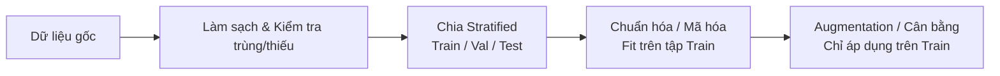

02 • DỮ LIỆU &amp; TIỀN XỬ LÝ (20%)

# Tổng quan Bộ dữ liệu

  <MetricCard label="Nguồn dữ liệu" value="[TODO]" subtext="Kaggle / Roboflow" accent="blue" />
  <MetricCard label="Tổng số mẫu" value="[TODO]" subtext="Train / Val / Test" accent="slate" />
  <MetricCard label="Số lớp (Classes)" value="[TODO]" subtext="[TODO: tên các lớp]" accent="emerald" />
  <MetricCard label="Đầu vào / Đặc trưng" value="[TODO]" subtext="[TODO: kích thước ảnh / số cột]" accent="amber" />

  <FigureSlot
    expectedFile="public/figures/class_distribution.png"
    caption="Hình 1: Phân bố số lượng mẫu theo từng lớp"
    hint="Biểu đồ cột thể hiện số mẫu mỗi lớp và mức độ cân bằng / mất cân bằng dữ liệu."
    maxHeight="230px"
  />
  <FigureSlot
    expectedFile="public/figures/dataset_samples.png"
    caption="Hình 2: Mẫu dữ liệu tiêu biểu"
    hint="Lưới ảnh mẫu kèm nhãn thật hoặc tóm tắt đặc trưng tiêu biểu của các lớp."
    maxHeight="230px"
  />

<!--
[0:50 – 1:35 | ~45s]
- Về dữ liệu, nhóm sử dụng bộ dữ liệu [TODO: tên dataset] lấy từ [Kaggle/Roboflow], gồm tổng cộng [TODO] mẫu chia thành [TODO] lớp.
- Nhìn vào Hình 1, ta có thể thấy phân bố giữa các lớp [cân bằng / có sự chênh lệch ở lớp ...], đây là cơ sở để nhóm quyết định phương án chia tập và chọn metric đánh giá như Macro F1 bên cạnh Accuracy.
- Hình 2 minh họa một số mẫu tiêu biểu cho thấy độ đa dạng cũng như nhiễu tự nhiên trong dữ liệu.
-->

---

02 • DỮ LIỆU &amp; TIỀN XỬ LÝ (20%)

# Tiền xử lý &amp; Tăng cường Dữ liệu

  

    <h2>1. Chia tập &amp; Chuẩn hóa Dữ liệu</h2>
    <ul class="text-xs mb-0">
      <li><strong>Tỉ lệ chia tập:</strong> [TODO: VD 70% Train / 15% Val / 15% Test — Stratified]</li>
      <li><strong>Làm sạch:</strong> [TODO: xử lý missing values / ảnh hỏng / dữ liệu trùng lặp]</li>
      <li><strong>Chuẩn hóa / Mã hóa:</strong> [TODO: Resize + Normalize theo ImageNet, hoặc StandardScaler / One-Hot / Tokenize]</li>
    </ul>
  

  

    <h2>2. Augmentation &amp; Xử lý Mất cân bằng</h2>
    <ul class="text-xs mb-0">
      <li><strong>Data Augmentation:</strong> [TODO: Flip, Rotation, ColorJitter... hoặc N/A nếu tabular]</li>
      <li><strong>Xử lý mất cân bằng lớp:</strong> [TODO: Class weights / Oversampling / Không cần nếu cân bằng]</li>
      <li><strong>Chống rò rỉ dữ liệu:</strong> Mọi bước fit scaler và augmentation chỉ thực hiện trên tập <code>Train</code>; tập <code>Val</code> và <code>Test</code> giữ nguyên phân bố thật.</li>
    </ul>
  

<!--
[1:35 – 2:15 | ~40s]
- Để đảm bảo mô hình học hiệu quả và đánh giá khách quan, nhóm xây dựng pipeline tiền xử lý gồm 4 bước rõ ràng.
- Dữ liệu được chia theo tỉ lệ [TODO] có phân tầng (stratified) để giữ nguyên tỉ lệ các lớp.
- Mọi thống kê chuẩn hóa như mean/std hay bộ tăng cường dữ liệu chỉ được fit hoặc áp dụng trên tập Train, tránh hoàn toàn hiện tượng data leakage sang tập Val và Test.
-->
