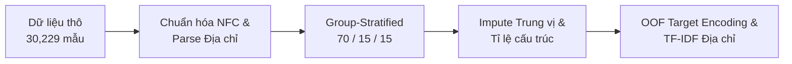

02 • DỮ LIỆU &amp; TIỀN XỬ LÝ (20%)

# Tổng quan Bộ dữ liệu

  <MetricCard label="Nguồn dữ liệu" value="Kaggle 2024" subtext="Tin đăng BĐS Việt Nam" accent="blue" />
  <MetricCard label="Tổng số mẫu" value="30,229" subtext="Train 21,161 / Val 4,535 / Test 4,533" accent="slate" />
  <MetricCard label="Biến mục tiêu (Price)" value="1.0 – 11.5 tỷ" subtext="Trung vị 5.90 | Std 2.21" accent="emerald" />
  <MetricCard label="Đặc trưng đầu vào" value="11 cột" subtext="1 văn bản + 6 số + 4 phân loại" accent="amber" />

  <FigureSlot
    expectedFile="public/figures/price_distribution.png"
    caption="Hình 1: Phân bố giá bán (tỷ VND) và đơn giá theo m²"
    hint="Biểu đồ phân bố Price (gần đối xứng quanh 5.9 tỷ) và Price/m² lệch phải."
    maxHeight="230px"
  />
  <FigureSlot
    expectedFile="public/figures/dataset_samples.png"
    caption="Hình 2: Tương quan Diện tích, Thành phố &amp; Giá bán"
    hint="Scatter/Boxplot thể hiện chênh lệch giá giữa TP.HCM, Hà Nội và các tỉnh."
    maxHeight="230px"
  />

<!--
[0:50 – 1:35 | ~45s]
- Bộ dữ liệu gồm 30,229 tin đăng với 12 cột, trong đó không có dòng trùng lặp hoàn toàn nhưng tỉ lệ thiếu dữ liệu ở các cột phụ rất cao (như Mặt tiền 38%, Đường vào 44%, Hướng ban công 83%).
- Biến mục tiêu Price nằm trong khoảng 1.0 đến 11.5 tỷ VND với trung vị 5.90 tỷ; TP.HCM và Hà Nội chiếm 73.6% tổng số mẫu.
-->

---

02 • DỮ LIỆU &amp; TIỀN XỬ LÝ (20%)

# Tiền xử lý &amp; Kỹ thuật Tạo Đặc trưng (Feature Engineering)

  

    <h2>1. Làm sạch &amp; Chia tập Không rò rỉ</h2>
    <ul class="text-xs mb-0">
      <li><strong>Không dùng <code>dropna()</code>:</strong> Chỉ còn 8.75% dữ liệu nếu xóa NaN; thay bằng <strong>Train-only median imputation</strong> + cờ báo thiếu.</li>
      <li><strong>Chuẩn hóa tiếng Việt:</strong> Unicode NFC gộp lỗi dấu (<code>Hà Nội</code>) và gộp alias (<code>TP. HCM</code> → <code>Hồ Chí Minh</code>).</li>
      <li><strong>Group-Stratified Split:</strong> Gom 1,631 nhóm tin đăng lại cùng nhà về cùng một tập, phân tầng theo 10 mức giá.</li>
    </ul>
  

  

    <h2>2. Tạo Đặc trưng &amp; Biến đổi Mục tiêu</h2>
    <ul class="text-xs mb-0">
      <li><strong>Đặc trưng cấu trúc:</strong> <code>log1p(Area)</code>, <code>Area × Floors</code>, <code>Area/Floor</code>, <code>Total_Rooms</code>, từ khóa <code>is_project</code> / <code>is_alley</code>.</li>
      <li><strong>OOF Geo &amp; Văn bản:</strong> 5-fold OOF <code>Price/m²</code> theo cấp <code>City → District → Ward → Street</code> + <code>Ridge TF-IDF</code> trên địa chỉ.</li>
      <li><strong>Thử nghiệm Target:</strong> Đối chiếu <code>raw</code>, <code>log1p</code>, <code>price_per_m2</code> và quy đổi về tỷ VND.</li>
    </ul>
  

<!--
[1:35 – 2:15 | ~40s]
- Vì dropna() làm mất tới 91% dữ liệu, nhóm giữ toàn bộ mẫu bằng cách điền khuyết trung vị theo quận/huyện chỉ fit trên tập Train và bổ sung biến cờ báo thiếu.
- Nhóm cũng sửa lỗi Unicode tiếng Việt và dùng Group-Stratified Split để tin đăng lặp của môi giới không bị rò rỉ từ Train sang Test.
-->
